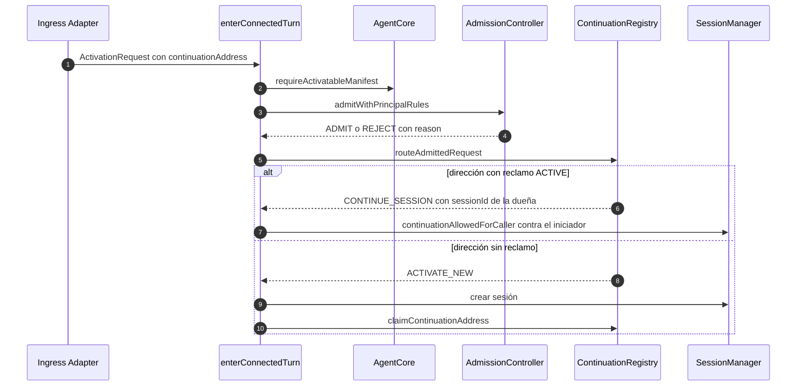
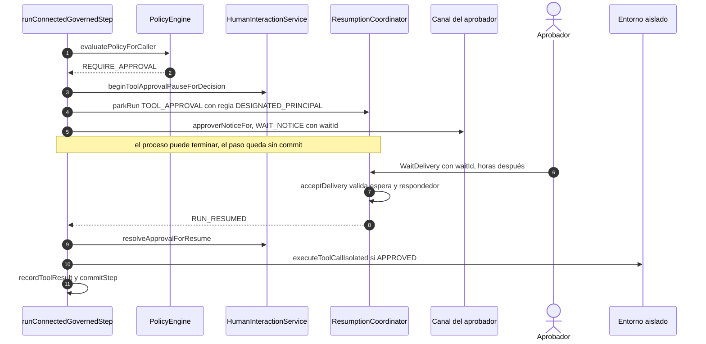
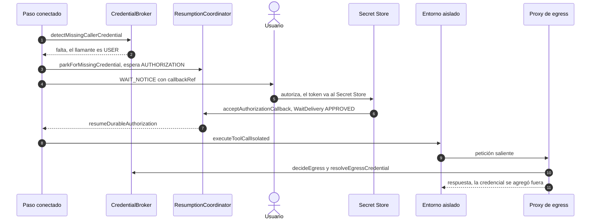
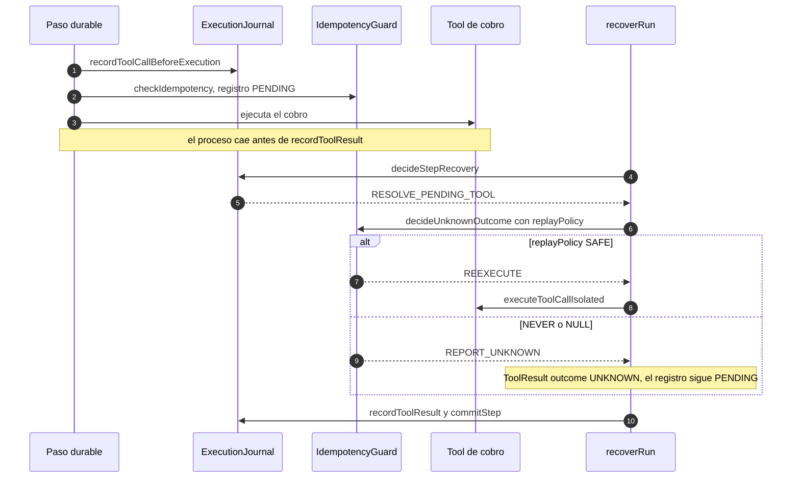
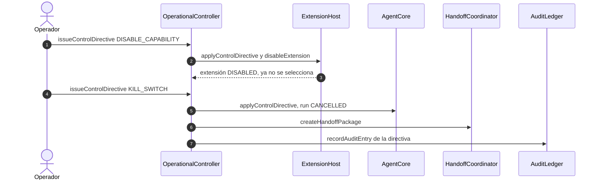
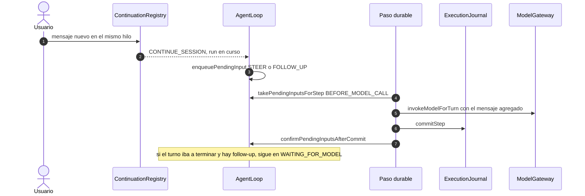
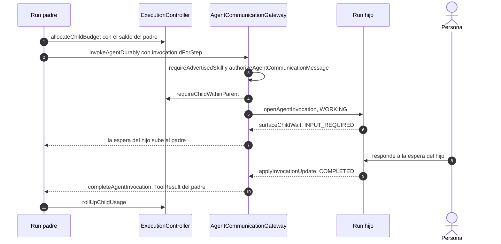
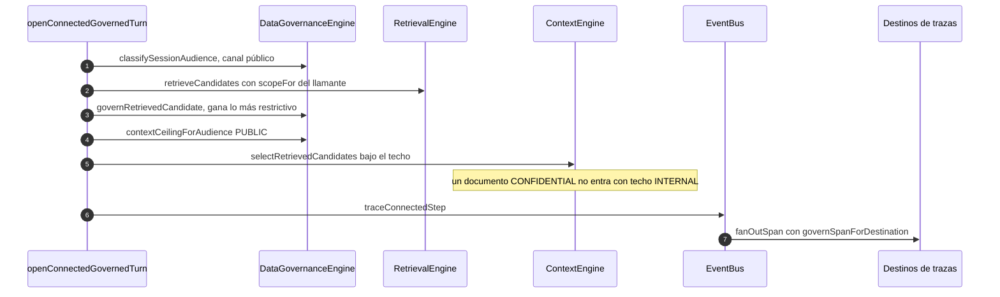
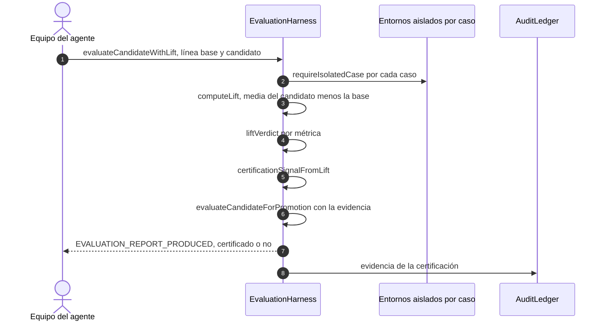
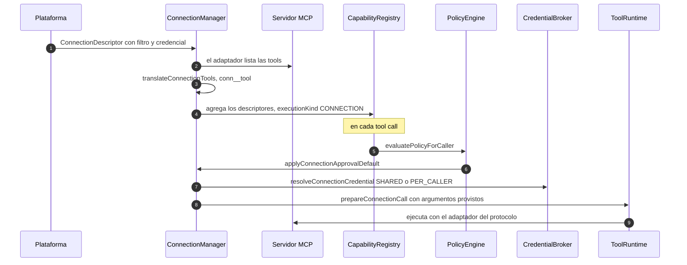

# book-harness — 10 flujos empresariales

[[BH-Arquitectura-y-Flujos]] · [[BH-Implementacion]] · [[BH-Diagramas-Archify]]

Diez escenarios empresariales resueltos con la arquitectura del libro en su **versión 0.3**: operación durable y conectividad sobre la capa enterprise. Cada flujo trae:
- un **diagrama de secuencia numerado**;
- un **paso a paso** con la misma numeración;
- los **componentes** que intervienen;
- **puntos de control**: fallos, límites y huecos del pseudocódigo.

Los nombres de función son los del pseudocódigo del libro.

> **Importante:** el libro es pseudocódigo. Estos flujos describen **cómo diseñar** cada caso, no un software que se pueda instalar.
>
> - Abreviatura: `chNN` = `repos/aaramirez/book-harness/book/chapters/NN-*/chapter.md`.
> - Commit estudiado: `59288a1`.

| # | Flujo | Componentes | Caso típico |
| --- | --- | --- | --- |
| 1 | Admisión por principal y continuación de una conversación | AdmissionController + ContinuationRegistry | Un mensaje nuevo en un hilo de Slack o en un issue |
| 2 | Aprobación durable con aviso al aprobador | PolicyEngine + ResumptionCoordinator + HumanInteractionService | Un pago que aprueba otra persona, horas después y por otro canal |
| 3 | Credencial del usuario: autorización y egress | CredentialBroker + ResumptionCoordinator + IsolatedExecutionEnvironment | Llamar al CRM con la cuenta del usuario, sin que el secreto toque el sandbox |
| 4 | Efecto con resultado desconocido tras una caída | ExecutionJournal + IdempotencyGuard | Cobro o envío interrumpido por un reinicio |
| 5 | Kill switch y apagado de una extensión | OperationalController + ExtensionHost + HandoffCoordinator + AuditLedger | Incidente: detener un agente o una extensión ya |
| 6 | Mensajes que llegan durante el turno | ContinuationRegistry + AgentLoop + ExecutionJournal | El usuario corrige la instrucción mientras el agente trabaja |
| 7 | Invocación durable entre agentes con presupuesto heredado | AgentCommunicationGateway + ExecutionController | Un agente de ventas delega en uno de facturación |
| 8 | Datos gobernados y trazas acotadas por audiencia | RetrievalEngine + DataGovernanceEngine + EventBus | Responder en un canal público sin filtrar datos confidenciales |
| 9 | Certificación con lift antes de promover | EvaluationHarness | Probar que una versión nueva mejora sin empeorar |
| 10 | Conectar un servidor MCP como fuente de capabilities | ConnectionManager + CapabilityRegistry + PolicyEngine | Sumar las tools del sistema de tickets |

---

## Flujo 1 — Admisión por principal y continuación de una conversación

**Objetivo:** que ningún estímulo externo arranque o continúe un agente sin una identidad verificada y una decisión explícita (P-17, P-31, INV-E15). Además, que cada conversación externa tenga **una sola** sesión dueña (P-34, INV-E19).

**Paso a paso:**
- **1.** El adaptador normaliza el mensaje en un `ActivationRequest` con su dirección, por ejemplo `chat-equipo` / "hilo 1718". El ingreso nunca llama a AgentLoop.
- **2.** El manifiesto del agente se revisa primero. Un diagnóstico ERROR bloquea la activación (INV-E27).
- **3-4.** La admisión exige un principal verificado:
  - un harness sin reglas configuradas admite solo en DEVELOPMENT;
  - un principal que ninguna regla admite da REJECT `PRINCIPAL_NOT_ADMITTED`;
  - con REJECT, la función devuelve NULL y no existe run.
- **5-7.** Con un reclamo ACTIVE, el mensaje continúa la sesión dueña. El llamante debe ser el mismo principal o del mismo tenant que el iniciador; si no, `SESSION_CONTINUATION_NOT_ALLOWED`.
- **8-10.** Sin reclamo, se crea la sesión y se reclama la dirección. Si otra sesión ya la tiene, `CONTINUATION_ADDRESS_ALREADY_OWNED`.

**Componentes:** AdmissionController (CMP-012), ContinuationRegistry (CMP-025), SessionManager (CMP-010) y AgentCore (CMP-011).

**Puntos de control:**
- La continuación se audita con `auditSessionContinuation` (CH-38).
- `routeAdmittedRequest` no emite eventos, y la denegación de continuación tampoco.
- Con CONTINUE_SESSION, un run en curso recibe el mensaje como `PendingInput` (flujo 6). Un run estacionado lo recibe en `ResumptionCoordinator`, si el mensaje nombra la espera (flujo 2).

**Evidencia:**
- `ch49:473-514`: `enterConnectedTurn`.
- `ch38:494-528`: `admitWithPrincipalRules`.
- `ch31:514-585`: `admitWithVerifiedIdentity`.
- `ch31:618-631`: `continuationAllowedForCaller`.
- `ch34:576-619`, `ch34:747-752`: `routeAdmittedRequest` y su tabla.
- `ch34:623-679`: `claimContinuationAddress`.
- `ch34:481-488`: qué pasa después de enrutar.
- `ch38:694-706`: `auditSessionContinuation`.

---

## Flujo 2 — Aprobación durable con aviso al aprobador

**Objetivo:** que una acción sensible no se ejecute sin una resolución válida (INV-15) y que la espera no retenga cómputo (P-33). El aprobador puede responder horas después y desde otro canal, pero solo a la espera que corresponde (INV-E18).

**Paso a paso:**
- **1-2.** La política por llamante exige aprobación.
- **3-4.** Se crea la solicitud y se estaciona el run. La espera es un registro durable (`ParkedWait`) con regla de respondedor y vencimiento. El estado pasa a WAITING_FOR_HUMAN.
- **5.** Si el aprobador designado no está en la sesión, recibe un `OutboundMessage` de tipo WAIT_NOTICE **en su dirección**, no en la de la sesión.
- **6.** No queda nada esperando en memoria. El paso queda STARTED y sin commit.
- **7-8.** La entrega debe nombrar su `waitId`; el harness nunca la infiere. `acceptDelivery` revisa en orden:
  1. `WAIT_NOT_ADDRESSED`;
  2. `WAIT_ALREADY_RESUMED`;
  3. `WAIT_EXPIRED`;
  4. `RESPONDER_NOT_AUTHORIZED`.

  Si falla alguna, la espera sigue PARKED.
- **9-10.** Con la entrega aceptada se reanuda el run, y la resolución queda a nombre del aprobador (`resolvedBy`).
- **11-12.** Con APPROVED se ejecuta **como el llamante original**. Con REJECTED se hace commit sin tool call y el modelo recibe la observación.

**Componentes:** PolicyEngine (CMP-005), HumanInteractionService (CMP-006), ResumptionCoordinator (CMP-024) y IsolatedExecutionEnvironment (CMP-026).

**Puntos de control:**
- El aprobador nunca pasa a ser el llamante (`ch36:750-752`).
- `approverNoticeFor` exige la regla DESIGNATED_PRINCIPAL con un designado. Si no, `APPROVER_NOT_DESIGNATED`.
- Al vencer, un schedule interno expira la espera (`WAIT_EXPIRED`) y el turno sigue con esa observación (CH-37).
- Eventos: POLICY_EVALUATED → HUMAN_INTERACTION_REQUESTED → SESSION_CHECKPOINT_CREATED → RUN_PARKED … RUN_RESUMED → HUMAN_INTERACTION_RESOLVED → TOOL_CALL_COMPLETED → STEP_COMMITTED.

**Evidencia:**
- `ch49:817-834`: rama de aprobación del paso conectado.
- `ch49:677-702`: `approverNoticeFor`.
- `ch33:372-386`: `ParkedWait`.
- `ch33:598-653`: `parkRun`.
- `ch33:742-758`: regla de respondedor.
- `ch33:795-846`: `acceptDelivery`.
- `ch36:591-647`: `resumeDurableApproval`.
- `ch36:743-746`: orden de eventos.
- `ch37:487-587`: vencimiento.

---

## Flujo 3 — Credencial del usuario: autorización interactiva y egress

**Objetivo:** llamar a un sistema externo **con la cuenta del usuario** sin que el secreto llegue nunca al modelo ni al sandbox (P-35, INV-E08, INV-E20). Si al usuario le falta la credencial, el run espera su autorización.

**Paso a paso:**
- **1-2.** Si el secreto del usuario no existe y el llamante es un USER, falta la credencial.
- **3-4.** Se crea un desafío de autorización y se estaciona el run. La regla es SAME_PRINCIPAL: solo el mismo usuario puede completarlo. El aviso sale como WAIT_NOTICE.
- **5-6.** El token va al Secret Store, **nunca al run**. El callback valida `callbackRef`, el desafío, el mismo principal y el vencimiento; si algo falla, `AUTHORIZATION_CALLBACK_REJECTED`.
- **7-8.** Se reanuda y se ejecuta en el entorno aislado de la sesión.
- **9-11.** El proxy de egress decide DENY, ALLOW o ALLOW_WITH_CREDENTIAL. En el último caso agrega la credencial **fuera** del entorno. `EgressRule.credentialName` es un nombre, nunca un valor.

**Componentes:** CredentialBroker (CMP-014), ResumptionCoordinator (CMP-024) e IsolatedExecutionEnvironment (CMP-026).

**Puntos de control:**
- `buildSandboxEnvironment` falla con `SECRET_IN_SANDBOX_ENVIRONMENT` si la configuración nombra una credencial.
- Una capability aislada sin sandbox abierto falla con `ISOLATED_ENVIRONMENT_REQUIRED`.
- **Hallazgo corregido en `b687f2c`:** `parkForMissingCredential` ahora aplica `parkedAgentState`, y el run queda PAUSED (`AuthorizationParking.pausedState`). Hasta `59288a1` seguía RUNNING.
- En una conexión con `CredentialScope = PER_CALLER` vale lo mismo (CH-41).

**Evidencia:**
- `ch37:593-605`: `detectMissingCallerCredential`.
- `ch37:749-771`: `parkForMissingCredential`.
- `ch37:609-662`: `acceptAuthorizationCallback`.
- `ch37:819-887`: `resumeDurableAuthorization`.
- `ch35:539-558`: secretos fuera del sandbox.
- `ch35:621-701`, `ch35:814-821`: egress.
- `ch49:708-737`: `credentialForConnectedCall`.
- `ch41:718-744`: credencial de una conexión.

---

## Flujo 4 — Efecto con resultado desconocido tras una caída

**Objetivo:** que un reinicio a mitad de una tool call no duplique un cobro ni lo dé por hecho sin saberlo. Un paso confirmado nunca se repite (INV-E16), y un efecto incierto solo se repite si la capability lo declaró seguro (INV-E17).

**Paso a paso:**
- **1-3.** La tool call queda registrada **antes** del efecto, y la clave de idempotencia queda PENDING.
- **4.** El proceso cae: hay toolCall pero no toolResult.
- **5-6.** Al arrancar, el journal detecta qué paso tiene un efecto pendiente. Decidir si se repite le toca a IdempotencyGuard, no al journal.
- **7-10.** Con la política SAFE se reejecuta. Con NEVER, o sin política (NULL equivale a NEVER), el modelo recibe `TOOL_OUTCOME_UNKNOWN` y el registro no se marca como completado.
- **11.** Se registra el resultado y el paso queda confirmado. En la siguiente recuperación será REPLAY_RECORDED.

**Componentes:** ExecutionJournal (CMP-023) e IdempotencyGuard (CMP-015).

**Puntos de control:**
- Si la ejecución sigue en vuelo, `decideUnknownOutcome` responde WAIT. En recuperación eso es imposible, porque `executionStillInFlight=FALSE`.
- Declarar `SAFE` se audita al registrar la capability (`auditSafeReplayDeclaration`, CH-38).
- Las tools que vienen de una conexión tienen `replayPolicy` NULL, es decir NEVER (CH-41).

**Evidencia:**
- `ch32:465-473`, `ch32:743-778`, `ch32:851-858`: el journal y la decisión de recuperación.
- `ch30:542-617`, `ch30:621-652`, `ch30:668-677`: replay, resultado desconocido y ciclo del registro.
- `ch36:651-699`: `resolvePendingStepOnRecovery`.
- `ch17:971`, `ch17:1021`: idempotencia.
- `ch38:678-690`: auditoría de SAFE.

---

## Flujo 5 — Kill switch y apagado de una extensión

**Objetivo:** detener un agente, o apagar una extensión que se porta mal, **sin depender de AgentLoop** (P-30, INV-E14). Además, pasar el caso a una persona con evidencia.

**Paso a paso:**
- **1-3.** `disableExtension` exige una directiva DISABLE_CAPABILITY cuyo `targetRef` sea la extensión. Si no, `DIRECTIVE_NOT_FOR_EXTENSION`. Una extensión DISABLED queda fuera de `hooksFor`, que solo elige las ACTIVE.
- **4-5.** El kill switch pasa el run a CANCELLED desde cualquier estado no terminal. Sobre un estado terminal lanza un error: nunca reescribe un final ya alcanzado.
- **6.** El caso pasa a una persona con un paquete estructurado (CH-23, integrado en CH-27).
- **7.** La directiva queda en el ledger append-only, separado de la telemetría (P-25).

**Componentes:** OperationalController (CMP-016), ExtensionHost (CMP-027), AgentCore (CMP-011), HandoffCoordinator (CMP-021) y AuditLedger (CMP-017).

**Puntos de control:**
- Las otras directivas son ISOLATE_TENANT y ROLLBACK.
- Una extensión cuyo hash cambió queda REJECTED al registrarse, sin necesidad de una directiva (CH-40).
- En la invocación entre agentes, cancelar al padre emite un KILL_SWITCH para el hijo INTERNAL (CH-44).

**Evidencia:**
- `ch18:776-779`, `ch18:827-829`: tipos de directiva y `targetRef`.
- `ch18:1083`, `ch18:1114`, `ch18:1140-1170`: emisión y aplicación; el kill switch no toca un estado terminal.
- `ch49:643-671`, `ch49:461-464`: `disableExtension` y el flujo del operador.
- `ch40:633`: `hooksFor` solo elige extensiones ACTIVE.
- `ch27:579`: `interruptGovernedEnterpriseRunWithKillSwitch`.
- `ch23:998`: `createHandoffPackage`.
- `ch19:1027`: `recordAuditEntry`.

---

## Flujo 6 — Mensajes que llegan durante el turno

**Objetivo:** que el usuario pueda corregir o agregar algo mientras el agente trabaja, sin interrumpir una tool a medias y sin perder el mensaje si el proceso cae.

**Paso a paso:**
- **1-2.** El mensaje llega a la sesión dueña de la dirección. Como hay un run en curso, entra como `PendingInput`.
- **3.** Hay dos tipos:
  - **STEER:** se aplica antes de la siguiente llamada al modelo y nunca interrumpe una tool;
  - **FOLLOW_UP:** se aplica solo cuando el turno iba a terminar.
- **4-5.** El paso toma las entradas **solo antes de llamar al modelo**, nunca entre las propuestas de una misma respuesta (CH-49).
- **6-7.** La cola se confirma recién **después** del commit. Si el proceso cae antes, la entrada se vuelve a aplicar.
- **8.** `resolveCompletionWithPendingInput` evita COMPLETED mientras quede follow-up.

**Componentes:** ContinuationRegistry (CMP-025), AgentLoop (CMP-001), ExecutionJournal (CMP-023) y ModelGateway (CMP-003).

**Puntos de control:**
- `enqueuePendingInput` rechaza runs terminales.
- La entrega puede ser ONE_AT_A_TIME o ALL.
- En el turno durable solo está cableada la frontera BEFORE_MODEL_CALL (`ch38:611`). WOULD_COMPLETE se define en CH-28.
- Si hace falta compactar, la compactación es su propio paso del journal y va antes de tomar las entradas (CH-38).

**Evidencia:**
- `ch28:332-336`, `ch28:546-606`, `ch28:628-695`: tipos, cola, fronteras y completitud.
- `ch34:481-488`: el mensaje entra como `PendingInput`.
- `ch38:605-627`, `ch38:433-434`: tomar y confirmar alrededor del commit.
- `ch49:786-807`, `ch49:932-933`: dentro del paso conectado.

---

## Flujo 7 — Invocación durable entre agentes con presupuesto heredado

**Objetivo:** que un agente delegue en otro sin que el hijo gaste más que lo que le queda al padre (INV-E21) y sin que un reinicio duplique la invocación. La espera del hijo debe poder subir al padre.

**Paso a paso:**
- **1.** El presupuesto del hijo sale del **saldo** del padre, dividido por el fanout. Si no alcanza, `FANOUT_EXCEEDS_REMAINING_BUDGET`.
- **2.** El id de la invocación es determinista por paso y tool call. Tras un reinicio se devuelve la invocación existente en vez de abrir otra.
- **3-5.** El hijo debe anunciar la skill en su `AgentCard`, el grant debe autorizar el mensaje y el presupuesto debe caber. Si no, `CHILD_BUDGET_EXCEEDS_PARENT`.
- **6-8.** Si el hijo espera a una persona, la invocación pasa a INPUT_REQUIRED o AUTHORIZATION_REQUIRED con su `pendingWaitId`. Esto vale solo para hijos INTERNAL. El padre espera en WAITING_FOR_TOOL.
- **9-10.** El resultado del hijo vuelve como el `ToolResult` del padre.
- **11.** El uso del hijo se suma al del padre: tool calls, tokens y costo, pero no el tiempo ni la concurrencia.

**Componentes:** AgentCommunicationGateway (CMP-013) y ExecutionController (CMP-007).

**Puntos de control:**
- Un agente EXTERNAL (A2A) no recibe el llamante reenviado. El adaptador A2A traduce estados y cancelación, y el núcleo no conoce A2A.
- Cancelar al padre cancela al hijo INTERNAL con un KILL_SWITCH: `PARENT_CANCELLED`.
- Los límites del sandbox (`sandboxLimits`) se heredan. Si se exceden: `SANDBOX_LIMIT_EXCEEDED`.

**Evidencia:**
- `ch43:432-499`, `ch43:503-545`, `ch43:549-597`: reparto, verificación y suma.
- `ch44:813-854`: `invokeAgentDurably`.
- `ch44:588-664`: `openAgentInvocation`.
- `ch44:770-806`: `surfaceChildWait`.
- `ch44:858-901`: cierre y uso del padre.
- `ch44:905-942`: cancelación.
- `ch44:574-584`, `ch44:954-962`: A2A.
- `repos/aaramirez/book-harness/docs/adr/ADR-004-presupuesto-jerarquico.md:16-19`: ADR-004.

---

## Flujo 8 — Datos gobernados y trazas acotadas por audiencia

**Objetivo:** que un agente responda con datos de la empresa sin meter en el contexto algo por encima de lo que la audiencia puede ver. Además, que las trazas no capturen lo que no deben (P-37, INV-E23, INV-E26).

**Paso a paso:**
- **1.** La sesión se clasifica por audiencia: PUBLIC, PRIVATE o UNKNOWN. La clasificación solo puede volverse más restrictiva.
- **2.** Cada fuente aplica su regla de alcance sobre el llamante verificado: SHARED, PER_TENANT o PER_PRINCIPAL. Una fuente sin clasificación declarada es RESTRICTED.
- **3.** La etiqueta final es la más restrictiva entre la de la fuente y la de `classifyData`.
- **4-6.** En una sesión PUBLIC, el techo de contexto baja al techo público del despliegue. En el ejemplo del libro, la planilla de salarios (CONFIDENTIAL) no entra con techo INTERNAL.
- **7-8.** Cada destino de trazas recibe solo lo que su techo permite. Por encima del techo queda solo la metadata: `body` NULL y `redacted`.

**Componentes:** RetrievalEngine (CMP-029), DataGovernanceEngine (CMP-018), ContextEngine (CMP-004) y EventBus (CMP-009).

**Puntos de control:**
- Un resumen no puede bajar la clasificación: `classifyDerivedData` toma la más restrictiva.
- Una fuente PER_PRINCIPAL sin llamante falla con `CALLER_REQUIRED_FOR_SOURCE`.
- La retención del journal no vence mientras el run o un paso siguen abiertos, y el legal hold suspende el borrado (CH-38).
- **Hallazgo corregido en `b687f2c`:** desde la revisión, `connectedModelMessages` lleva los bloques gobernados a la llamada al modelo (ver [[BH-Arquitectura-y-Flujos]] §3).

**Evidencia:**
- `ch46:303-307`, `ch46:525-549`: audiencia; solo sube la restricción.
- `ch42:566-640`, `ch42:756-777`, `ch42:713-737`: alcance, gobierno y selección.
- `ch46:612-623`, `ch46:470-480`: techo de contexto y el ejemplo de los salarios.
- `ch46:583-608`, `ch46:627-689`: techo de captura, gobierno del span y fan-out.
- `ch42:668-707`: datos derivados.
- `ch38:716-742`: retención del journal.

---

## Flujo 9 — Certificación con lift antes de promover

**Objetivo:** promover una versión nueva de un agente solo si **mejora** frente a la actual en casos aislados, y nunca si empeora (P-28, INV-E13).

**Paso a paso:**
- **1-2.** Cada caso corre en su propio sandbox. Compartir uno falla con `SHARED_EVALUATION_ENVIRONMENT`. Una línea base igual al candidato falla con `SAME_BASELINE_AND_TREATMENT`.
- **3.** lift = media(candidato) − media(línea base). Se emite LIFT_REPORT_PRODUCED.
- **4.** El veredicto depende de los casos y del lift:
  - con menos casos que el mínimo, o un lift chico: INCONCLUSIVE;
  - con lift ≥ mínimo: IMPROVED;
  - con lift ≤ −mínimo: REGRESSED.
- **5.** La señal de certificación depende de los veredictos:
  - con cualquier REGRESSED: FALSE;
  - con todos IMPROVED: TRUE;
  - en cualquier otro caso: NULL, sin señal.
- **6-8.** El gate de CH-22 decide con esa evidencia, y el informe queda como evidencia (C-032 v2 `evidence`).

**Componentes:** EvaluationHarness (CMP-020), IsolatedExecutionEnvironment (CMP-026) y AuditLedger (CMP-017).

**Puntos de control:**
- Un resultado INCONCLUSIVE no certifica por sí solo: la decisión vuelve a las reglas de CH-22.
- La correlación con resultados de negocio se hace con `correlateRunWithBusinessOutcome` (CH-22).

**Evidencia:**
- `ch47:461-481`: `liftVerdict`.
- `ch47:485-571`: `computeLift`.
- `ch47:575-599`: `certificationSignalFromLift`.
- `ch47:603-656`, `ch47:678-684`: integración con la promoción.
- `ch22:1200`: `evaluateCandidateForPromotion`.
- `ch47:339-347`: C-032 v2.

---

## Flujo 10 — Conectar un servidor MCP como fuente de capabilities

**Objetivo:** sumar las tools de un sistema externo (MCP por stdio o HTTP, u OpenAPI) **sin abrir una puerta lateral**. Una tool externa llega al modelo solo como `CapabilityDescriptor` resuelto por CapabilityRegistry y evaluado por PolicyEngine (P-38, INV-E25).

**Paso a paso:**
- **1-4.** La conexión declara su tipo (MCP u OPENAPI), su transporte y un filtro ALLOW_LIST o BLOCK_LIST. `translateConnectionTools` le pone a cada tool el prefijo `<conexión>__<tool>`, saca del schema los argumentos que provee la plataforma, deja `replayPolicy` en NULL (NEVER) y fija `executionKind = CONNECTION`.
- **5-6.** Cada llamada pasa por la política normal. El default de aprobación de la conexión solo puede subir ALLOW a REQUIRE_APPROVAL.
- **7.** La credencial es compartida o del llamante. Si al usuario le falta, se pasa al flujo 3.
- **8-9.** El modelo no puede proveer un argumento reservado: `PROVIDED_ARGUMENT_FROM_MODEL`. El runtime ejecuta con el adaptador.

**Componentes:** ConnectionManager (CMP-028), CapabilityRegistry (CMP-008), PolicyEngine (CMP-005), CredentialBroker (CMP-014) y ToolRuntime (CMP-002).

**Puntos de control:**
- Dos tools con el mismo nombre final fallan con `CAPABILITY_NAME_COLLISION`.
- Una falla del servidor es un `ToolResult` fallido. Una caída a mitad de la llamada deja un resultado desconocido, y no se repite.
- La versión de cada conexión en uso queda en la sesión, y una sesión con trabajo vivo no migra (CH-45, INV-E22).

**Evidencia:**
- `ch41:334-381`: tipos y `ConnectionDescriptor`.
- `ch41:490-514`: al conectar y en cada llamada.
- `ch41:578-618`: `translateConnectionTools`.
- `ch41:622-658`: `prepareConnectionCall`.
- `ch41:692-744`: aprobación y credencial.
- `ch41:776-784`: fallos.
- `repos/aaramirez/book-harness/docs/adr/ADR-005-capability-desde-conexion.md:22-27`: ADR-005.
- `ch45:696-731`: versiones de conexión.

---

[[BH-Arquitectura-y-Flujos]] · [[BH-Implementacion]] · [[Matriz-Comparativa]]
