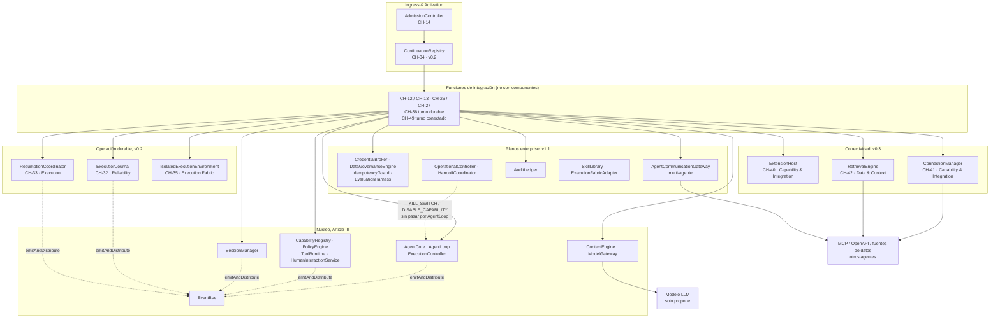
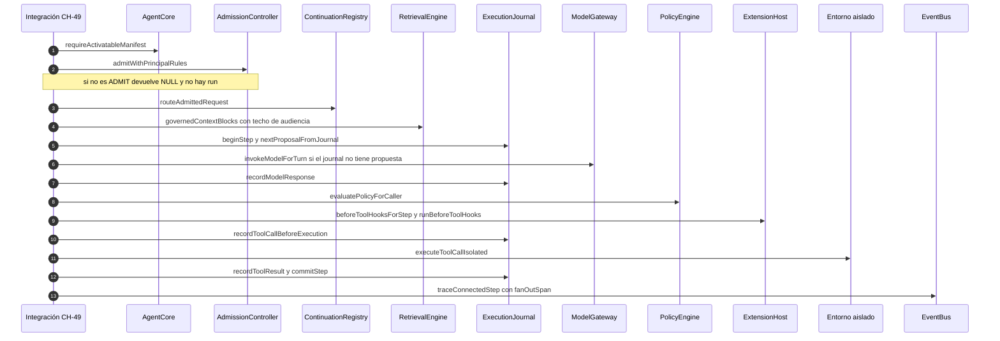
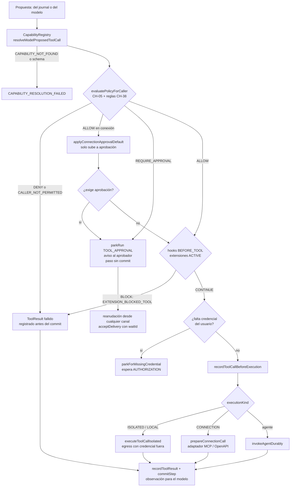
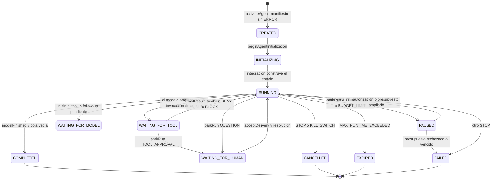
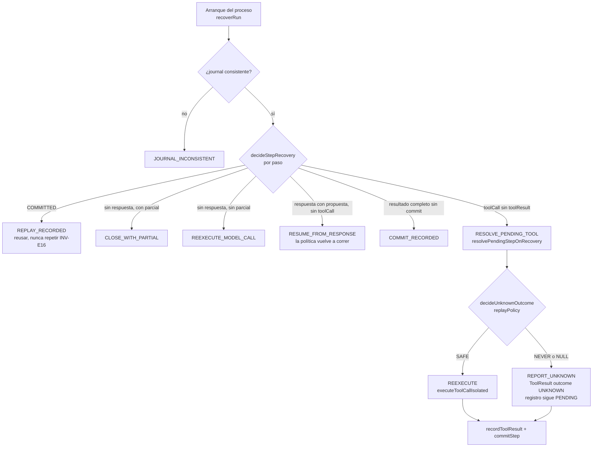
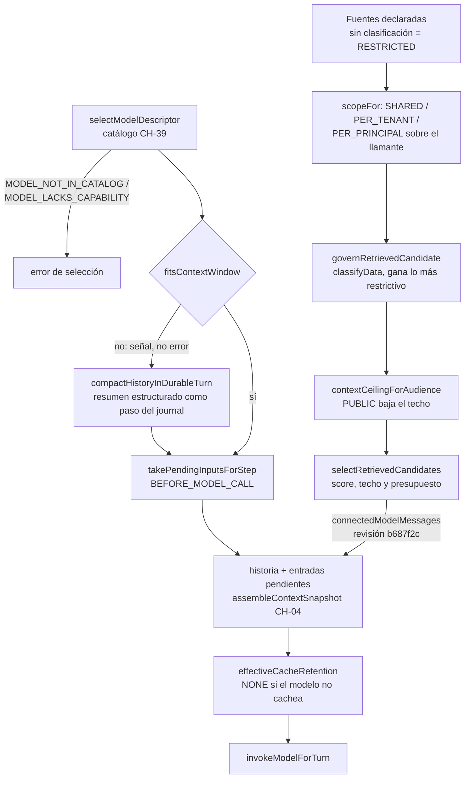
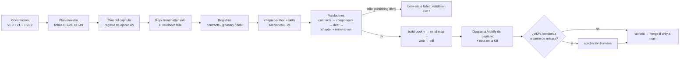

# book-harness — Arquitectura y flujos internos

[[BH-10-Flujos-Empresariales]] · [[BH-Implementacion]] · [[BH-Diagramas-Archify]] · [[BH-Estado-Implementacion]]

`aaramirez/book-harness` es el libro **"¿Cómo construir un arnés?"**, versión **0.3**. No contiene código ejecutable del harness. Tiene:
- 50 capítulos (CH-00..CH-49) con **pseudocódigo propio**;
- una **constitución arquitectónica**: v1.0 con las Enmiendas v1.1 (enterprise) y v1.2 (operación durable y conectividad);
- registros canónicos: 29 componentes, 66 contratos, 201 términos y 48 deudas, ninguna abierta;
- su propio arnés de producción del libro: validadores y build en Node.

Estos diagramas son **vistas transversales**. El libro trae 55 diagramas Archify: uno por capítulo y 5 generales, en `repos/aaramirez/book-harness/diagrams/archify/rendered/`. Ninguno de los generales cubre la v0.3, y esa es la vista que agrega este set.

- **Commit estudiado:** `59288a1` (2026-10-12, tag `v0.3` + KB). Después hubo dos revisiones:
  - `b687f2c` corrige los huecos de CH-37 y CH-49;
  - `45b3da6` corrige CH-25 (planos y secuencia) y los diagramas transversales del libro.
- **Abreviatura:** `chNN` = `repos/aaramirez/book-harness/book/chapters/NN-*/chapter.md`.
- **Set anterior:** describía la v0.1 (`d16e2c7`). El historial de git lo conserva.

---

## 1. Mapa de componentes v0.3: núcleo, planos enterprise, operación durable y conectividad

29 componentes: 11 de núcleo (Article III), 11 enterprise (Amendment v1.1), 4 de operación durable (v0.2) y 3 de conectividad (v0.3). Están agrupados en los planos que el libro les asigna.

**Los componentes no se llaman entre sí.** El registro declara `dependencies: []` en todos. Las llamadas ocurren en **funciones de integración**, que no son componentes:
- `runAgentTurnEndToEnd` (CH-12);
- `runGovernedEnterpriseTurn` (CH-26);
- `runDurableGovernedStep` (CH-36);
- `runConnectedGovernedStep` (CH-49).

**Evidencia:**
- `repos/aaramirez/book-harness/registry/components.yaml:174-929`: los 29 componentes, todos con `dependencies: []`.
- `repos/aaramirez/book-harness/constitution/ARCHITECTURE_CONSTITUTION.md:233-355` (Article III), `:991-1000` (los 9 planos) y `:1002-1046` (Amendment v1.2).
- `ch25:331-342`: los planos de CMP-012..022.
- `ch25:365-368`: los planos de CMP-023..026.
- `ch25:388-390`, `ch40:855`, `ch41:835` y `ch42:879`: los planos de CMP-027..029. CH-25 los declara desde `45b3da6`.
- `ch49:403-428`: dependencias del turno conectado.

> **Inconsistencias corregidas en `45b3da6`:**
> - CredentialBroker figuraba en "Data & Context" en `ch25:334`, pero CH-16 y `registry/components.yaml:101` lo ubican en "Capability & Integration". CH-25 ahora coincide y trae una fe de erratas (`ch25:403-405`).
> - Los planos de CMP-027..029 constaban solo en sus capítulos. Ahora también están en CH-25.

---

## 2. La frontera determinista / agéntica (Article XII y Amendment v1.2)

Regla suprema: *"Probabilistic systems may propose decisions. Deterministic systems must govern consequences."* La v1.2 no cambia el texto de Article XII. Agrega invariantes que cierran nuevas puertas laterales: extensiones, conexiones, secretos, autoría y migraciones.

```mermaid
flowchart LR
  subgraph AG["Agéntico: el LLM puede"]
    A1["interpretar intención<br/>y formar hipótesis"]
    A2["elegir capability<br/>y proponer tool calls"]
    A3["resumir la historia<br/>al compactar"]
  end
  B{{"FRONTERA DETERMINISTA"}}
  subgraph DET["Determinista: el runtime controla (v1.0 + v1.1)"]
    D1["identidad, admisión<br/>y autorización"]
    D2["schema, política,<br/>aprobaciones"]
    D3["budgets, idempotencia,<br/>auditoría"]
  end
  subgraph V12["Refuerzos v1.2"]
    R1["hooks solo CONTINUE / BLOCK / TRANSFORM<br/>INV-E24"]
    R2["tools externas solo como descriptor<br/>INV-E25"]
    R3["secretos nunca en el sandbox<br/>INV-E20"]
    R4["paso confirmado no se repite<br/>INV-E16 · E17"]
    R5["ERROR de autoría bloquea la activación<br/>INV-E27"]
  end
  RW["Mundo real"]
  AG -- "propone intención" --> B --> DET --> V12 -- "consecuencias gobernadas" --> RW
```

**Evidencia:**
- `repos/aaramirez/book-harness/constitution/ARCHITECTURE_CONSTITUTION.md:777-844`: Article XII y la regla suprema.
- `repos/aaramirez/book-harness/constitution/ARCHITECTURE_CONSTITUTION.md:1034-1046`: INV-E15..E27.
- `repos/aaramirez/book-harness/constitution/ARCHITECTURE_CONSTITUTION.md:771-773`: EVO-10, las extensiones no pueden saltarse la constitución.
- `ch40:406-410`: `HookOutcomeKind` sin valor "autorizado".

---

## 3. El turno conectado de punta a punta (CH-49)

Es la integración final de la v0.3, y CH-49 la presenta en **12 pasos en orden fijo**. Un turno se abre una vez (`enterConnectedTurn` + `openConnectedGovernedTurn`), y luego AgentLoop repite `runConnectedGovernedStep` paso a paso. El diagrama muestra la apertura y un paso con una tool call permitida.

**Paso a paso:**
- **1.** El manifiesto del agente no puede tener diagnósticos ERROR. Si los tiene: `AGENT_MANIFEST_REJECTED` y `AGENT_MANIFEST_HAS_ERRORS` (INV-E27).
- **2.** Admisión con reglas por principal. Con REJECT no se crea ningún run.
- **3.** La dirección de continuación decide entre sesión nueva y CONTINUE_SESSION. Si es CONTINUE_SESSION, `continuationAllowedForCaller` debe permitirlo; si no, `SESSION_CONTINUATION_NOT_ALLOWED`.
- **4.** `bindDurableCaller` fija el llamante. Luego se gobiernan los candidatos recuperados y se recortan con el techo de la audiencia.
- **5-7.** **El journal manda sobre el modelo.** Si la respuesta ya registrada del turno tiene propuestas sin ejecutar, se toma la siguiente sin volver a llamar al modelo (D-044). Si no, se toman las entradas pendientes y se invoca al modelo.
- **8.** La política por llamante solo puede restringir: convierte ALLOW en DENY `CALLER_NOT_PERMITTED`.
- **9.** Solo con ALLOW corren los hooks BEFORE_TOOL de extensiones activas. Las extensiones PROJECT corren solo en el entorno aislado.
- **10-12.** La tool call se registra **antes** de ejecutarse y se ejecuta aislada. Después se registran el resultado y el commit, y se confirman las entradas pendientes.
- **13.** La traza sale recortada al techo de captura de cada destino.

Ramas que no se dibujan:
- **REQUIRE_APPROVAL:** se estaciona el run (`parkRun`) con aviso al aprobador designado (`approverNoticeFor`) y se retorna **sin commit**. Ver el [[BH-10-Flujos-Empresariales|flujo 2]].
- **DENY o hook BLOCK:** se registra un `ToolResult` fallido **antes** del commit, para que `nextProposalFromJournal` no vuelva a ofrecer la misma propuesta.
- **Conexión o agente:** la conexión prepara su credencial (`credentialForConnectedCall`) antes de ejecutar, y el agente cambia `executeToolCallIsolated` por `invokeAgentDurably`.

**Evidencia:**
- `ch49:281-293`: los 12 pasos.
- `ch49:473-514`: `enterConnectedTurn`.
- `ch49:518-564`: contexto gobernado y apertura.
- `ch49:570-600`: `nextProposalFromJournal`.
- `ch49:743-879`: `runConnectedGovernedStep`.
- `ch49:885-893`: `traceConnectedStep`.
- `ch49:910-919`: por qué se registra un DENY, y las ramas de conexión y de agente.
- Diagrama del libro: `repos/aaramirez/book-harness/diagrams/archify/rendered/capitulo-49-integracion-conectada.html`.

> **Hallazgo corregido en `b687f2c`:** hasta `59288a1`, `openConnectedGovernedTurn` producía `contextBlocks`, pero `runConnectedGovernedStep` invocaba al modelo solo con `selection.messages`. La revisión agrega `connectedModelMessages(contextBlocks, selection)`: un `AgentMessage` USER por bloque, seguido de las entradas pendientes. El plan está en `repos/aaramirez/book-harness/planes/2026-10-12-revision-ch37-ch49-huecos.md`.

---

## 4. Gobierno de una tool call en la v0.3

Qué pasa entre "el modelo propone una tool" y "hay una observación". Toda capa nueva solo puede **restringir**:
- la política por llamante solo deniega;
- el default de aprobación de una conexión solo convierte ALLOW en REQUIRE_APPROVAL;
- un hook solo puede bloquear.

**Evidencia:**
- `ch38:534-574`: `evaluatePolicyForCaller`.
- `ch41:507-514`, `ch41:692-712`: orden por llamada en una conexión y default de aprobación.
- `ch40:608-621`, `ch40:719-763`: resultados permitidos y `runBeforeToolHooks`.
- `ch37:593-605`, `ch37:749-771`: credencial faltante y espera de autorización.
- `ch35:760-788`: `executeToolCallIsolated`.
- `ch41:664-686`: `effectiveExecutionKind`.
- `ch44:813-854`: `invokeAgentDurably`.
- `ch49:837-867`: DENY y BLOCK como `ToolResult` fallido.
- `ch33:795-846`: `acceptDelivery`.

---

## 5. Estados de un AgentRun en la v0.3

El enum **no cambió**: C-013 sigue en v1 con 11 valores. Lo que cambió es el **uso**: CH-33 es el primer capítulo que produce `PAUSED`, y las esperas durables reanudan desde cualquier canal.

**Evidencia:**
- `repos/aaramirez/book-harness/registry/contracts.yaml:250-270`: C-013 v1, `modified_by: []`.
- `ch33:575-584`, `ch33:657-669`, `ch33:911-916`: `runStatusForWait` y el primer uso de PAUSED.
- `ch28:713-719`: con follow-up pendiente el run queda en WAITING_FOR_MODEL.
- `ch37:891-933`, `ch37:968-970`: espera por presupuesto, ampliación o terminación.
- `ch44:969`: el padre espera al hijo en WAITING_FOR_TOOL.
- `ch18:1147-1167`: KILL_SWITCH.
- La recuperación tras una caída cambia el estado del **paso** (StepRecord), no el del run (`ch32:838`, `ch36:718`).

> **Hallazgo corregido en `b687f2c`:** hasta `59288a1`, `parkForMissingCredential` llamaba a `parkRun` pero no a `parkedAgentState`, y el run seguía RUNNING mientras esperaba la autorización. Ahora aplica `parkedAgentState` y devuelve el estado PAUSED en `AuthorizationParking.pausedState`.

---

## 6. Recuperación tras una caída a mitad de turno (CH-32, CH-30, CH-36)

El **paso** es la unidad de durabilidad (P-32). Al arrancar, `recoverRun` recorre el journal y decide qué hacer con cada paso. Si una tool quedó con resultado desconocido, decide la **política de replay** de la capability.

**Evidencia:**
- `ch32:465-473`: el journal en cada momento del turno.
- `ch32:743-778`, `ch32:851-858`: `decideStepRecovery` y su tabla.
- `ch32:782-823`: `recoverRun`.
- `ch30:334-337`, `ch30:512-521`: `ReplayPolicy`; NULL equivale a NEVER.
- `ch30:542-617`, `ch30:668-677`: `decideUnknownOutcome` y el ciclo del registro.
- `ch36:651-699`: `resolvePendingStepOnRecovery`; aquí WAIT es imposible.
- `ch36:753-755`: RESUME_FROM_RESPONSE vuelve a evaluar la política.

---

## 7. Qué ve realmente el modelo en la v0.3: ensamblado de contexto

En CH-04 el contexto era la historia recortada al presupuesto. En la v0.3 se suman:
- el catálogo del modelo (CH-39);
- la compactación con resumen estructurado (CH-29);
- la recuperación gobernada (CH-42);
- el techo por audiencia (CH-46).

**Evidencia:**
- `ch39:544-616`, `ch39:775`: selección, ventana de contexto y cache. Que no quepa es una señal para compactar.
- `ch29:580-761`: pipeline de compactación; nunca corta entre una tool call y su resultado.
- `ch38:605-669`: entradas pendientes y compactación como paso del journal.
- `ch42:493-494`, `ch42:522-531`, `ch42:566-595`, `ch42:713-737`, `ch42:756-777`: fuentes, alcance, gobierno y selección.
- `ch46:612-623`: techo por audiencia.
- `ch04:686-765`: `assembleContextSnapshot`.

> La arista de los bloques gobernados existe desde la revisión `b687f2c` (ver §3). Antes, el pseudocódigo de CH-49 no los pasaba a la llamada al modelo.

---

## 8. Cómo se produce el propio libro (arnés de producción v0.3)

El repo aplica su constitución a sí mismo. Desde la v0.2 hay un **registro de deuda** validado, un **plan maestro** y un plan por capítulo que funciona como registro de ejecución. Los ADRs, las enmiendas y los cierres de release requieren aprobación humana.

**Evidencia:**
- `repos/aaramirez/book-harness/planes/2026-09-24-extension-v0-2-v0-3-eve-pi-conexiones.md:25-32`: protocolo; aprobación humana en `:32` y `:418`.
- `repos/aaramirez/book-harness/planes/2026-09-24-extension-v0-2-v0-3-eve-pi-conexiones.md:390-419`: procedimiento por incremento.
- `repos/aaramirez/book-harness/scripts/build-all`: orden de validadores y build.
- `repos/aaramirez/book-harness/policies/publishing.yaml:13-14`: `unresolved_validation_errors: deny`.
- `repos/aaramirez/book-harness/registry/debt.yaml:9`, `:15-18`: estados de deuda; una deuda vencida falla el build.
- `repos/aaramirez/book-harness/agents/book-architect.md:7-8`: el arquitecto propone y no aprueba.

> La generación de diagramas Archify y del PDF ejecutivo (`scripts/build-flujos-doc.py`) sigue **fuera** de `build-all`.

---

[[BH-10-Flujos-Empresariales]] · [[BH-Implementacion]] · [[Matriz-Comparativa]]
