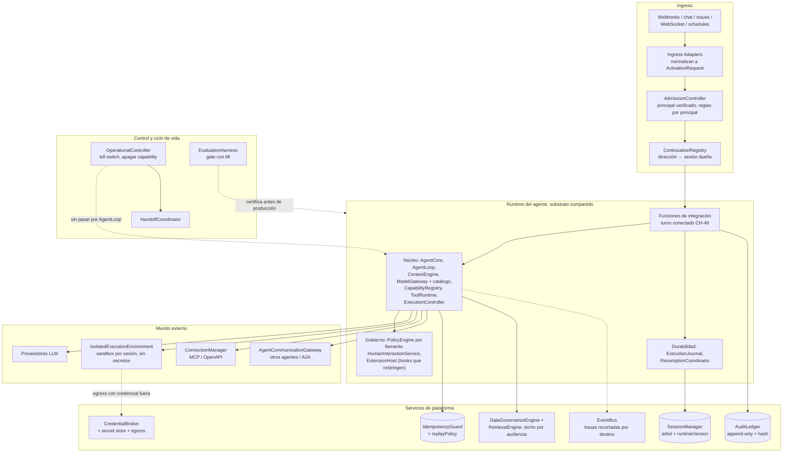
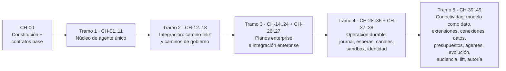
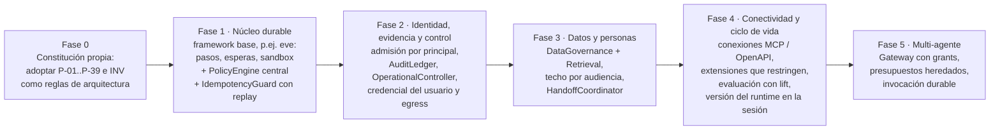

# book-harness — Cómo implementar la arquitectura en una empresa

[[BH-Arquitectura-y-Flujos]] · [[BH-10-Flujos-Empresariales]] · [[BH-Diagramas-Archify]] · [[vercel-eve]] · [[Eve-vs-BookHarness-vs-Pi]] · [[BH-Estado-Implementacion]]

**Respuesta corta:** el libro no se instala. Es una **especificación** en su versión 0.3: constitución con dos enmiendas, 29 componentes, 66 contratos y pseudocódigo. Implementarlo significa:
1. **construir** los componentes en el orden que el propio libro justifica (CH-25, cinco tramos);
2. **elegir tecnología real** para cada uno;
3. **aprovechar un framework existente** para lo que ya resuelve.

Con [[vercel-eve]] se cubre buena parte del núcleo y casi toda la **operación durable** de la v0.2: pasos, esperas, canales y sandbox. La v0.2 se diseñó a partir de las lecciones de eve. Sigue abierta la mayor parte de la **capa enterprise de gobierno**, junto con la recuperación gobernada y los hooks que solo restringen.

> Convención:
> - **[doc]** = lo dice el libro (`repos/aaramirez/book-harness/...`).
> - **[eve]** = según nuestro estudio de eve.
> - **[inferencia]** = recomendación nuestra.
>
> Abreviatura: `chNN` = `repos/aaramirez/book-harness/book/chapters/NN-*/chapter.md`. Commit estudiado: `59288a1`.

---

## 1. Arquitectura de referencia (v0.3)

**Evidencia:**
- `repos/aaramirez/book-harness/constitution/ARCHITECTURE_CONSTITUTION.md:926-1000`: Amendment v1.1 y los planos.
- `repos/aaramirez/book-harness/constitution/ARCHITECTURE_CONSTITUTION.md:1002-1046`: Amendment v1.2.
- `ch49:281-293`: el turno conectado.
- `repos/aaramirez/book-harness/constitution/ARCHITECTURE_CONSTITUTION.md:147`: P-15, substrato compartido.

---

## 2. Orden de construcción: lo que prescribe el libro (CH-25)

El principio rector sigue siendo **P-09: la confiabilidad de un solo agente precede a la complejidad multi-agente**. De los 29 componentes, solo `AgentCommunicationGateway` es multi-agente. La segunda pieza multi-agente, la invocación durable (CH-44), llega después de los presupuestos que se heredan (CH-43).

**Evidencia:**
- `ch25:313-342`: tramos 1 a 3.
- `ch25:352-380`: cierre de v0.2 y v0.2.1, con los planos de CMP-023..026.
- `ch25:382-401`: cierre de v0.3, tramo 5; CH-44 va después de CH-43 por P-09.
- `ch25:859-861`: totales de v0.3.

> Desde la revisión `45b3da6`, la vista de secuencia de CH-25 llega hasta CH-49 (`ch25:630-683`). El libro no deja **deudas abiertas** (`registry/debt.yaml`: 48 en total, 42 resueltas y 6 fuera de alcance). Los límites que declara a propósito están en la §18 de cada capítulo. Por ejemplo:
> - el bucle de pasos sigue siendo de AgentLoop;
> - las propuestas no se ejecutan en paralelo;
> - el directorio de direcciones de aprobadores es configuración del despliegue (`ch49:1011-1022`).

---

## 3. Los 29 componentes: tecnología sugerida y cobertura de eve

Leyenda de "¿Lo cubre eve?":
- **✔**: nativo;
- **◐**: parcial, hay que extenderlo;
- **✖**: no existe, hay que construirlo.

La columna de eve sale de [[vercel-eve]]. La de tecnología es **[inferencia]**.

| # | Componente | Responsabilidad [doc] | ¿Lo cubre eve? [eve] | Tecnología sugerida [inferencia] |
| --- | --- | --- | --- | --- |
| 1 | AgentCore | primitivas del agente; manifiesto sin ERROR antes de activar (CH-48) | ✔ `defineAgent` + directorio `agent/` | — |
| 2 | AgentLoop | ciclo modelo → acción → observación; steering y follow-up (CH-28) | ✔ 1 llamada por paso; steering y `turnPolicy: "queue"` | — |
| 3 | ModelGateway | adaptación de proveedores; catálogo con costo y cache (CH-39) | ✔ Vercel AI SDK / AI Gateway | LiteLLM o gateway propio, con catálogo versionado |
| 4 | ContextEngine | selección, compactación estructurada (CH-29), techo y presupuesto | ◐ hay compactación; techo por clasificación no | Resumen estructurado + ventana por modelo |
| 5 | ToolRuntime | valida, ejecuta, normaliza | ✔ `defineTool`, errores como datos | — |
| 6 | PolicyEngine | allow / deny / aprobación; reglas por llamante que solo restringen (CH-38) | ◐ `approval` por tool; sin motor central | OPA/Rego o Cedar, fail-closed |
| 7 | SessionManager | checkpoints, árbol de sesión (CH-29), `runtimeVersion` (CH-45) | ◐ sesión durable en Workflow; sin árbol | Postgres + checkpoints versionados |
| 8 | HumanInteractionService | solicitudes persistidas y resolución | ✔ `input.requested` / `inputResponses` | — |
| 9 | EventBus | distribución de eventos; spans recortados por audiencia (CH-46) | ✔ stream NDJSON, hooks, OTel con `audience` | OTel Collector con procesadores de redacción |
| 10 | ExecutionController | budgets; presupuesto hijo dentro del saldo del padre (CH-43) | ◐ caps de tokens y costo, reparto a subagentes | Contabilidad de uso por run y árbol de runs |
| 11 | CapabilityRegistry | intención → implementación, incluidas las de conexiones | ✔ archivos + `connection_search` | Catálogo de capabilities versionado (P-26) |
| 12 | AdmissionController | admisión con principal verificado | ◐ route auth + IP allow-list | API gateway + servicio de admisión |
| 13 | AgentCommunicationGateway | grants acotados; invocación durable entre agentes (CH-44) | ◐ remote agents con callbacks durables y `forwardPrincipal` | Grants firmados + adaptador A2A |
| 14 | CredentialBroker | referencia opaca; credencial del llamante (CH-37/38) | ✔/◐ `getToken` y brokering en el sandbox | Vault / Secrets Manager + OAuth por usuario |
| 15 | IdempotencyGuard | PENDING / COMPLETED; resultado desconocido según `replayPolicy` (CH-30) | ✖ las tools son responsables | Tabla de idempotencia con estados |
| 16 | OperationalController | kill switch fuera del loop; apagar extensiones | ◐ `cancel` / `reset` por sesión | Servicio de control + feature flags |
| 17 | AuditLedger | evidencia inmutable, distinta de la telemetría | ✖ OTel no es auditoría (P-25) | Append-only con hash encadenado / WORM |
| 18 | DataGovernanceEngine | clasificación, retención, legal hold; audiencia de la sesión | ◐ solo `audience` para capturar trazas | Catálogo de datos (DLP) + motor de retención |
| 19 | ExecutionFabricAdapter | topología independiente de la semántica | ✔/◐ Vercel o self-host | Kubernetes / ECS con placement por residencia |
| 20 | EvaluationHarness | certificación con lift en casos aislados (CH-47) | ◐ `eve eval`; sin gate por lift | Evals A/B en CI como gate |
| 21 | HandoffCoordinator | paquete estructurado hacia un humano | ✖ | ServiceNow, Jira SM o Zendesk |
| 22 | SkillLibrary | procedimientos consultables | ✔ skills + `load_skill` | — |
| 23 | ExecutionJournal | el paso como unidad de durabilidad; recuperación (CH-32) | ✔ `turnStep` con `"use step"` como checkpoint | Workflow engine (Temporal, Workflow DevKit) o tabla de pasos |
| 24 | ResumptionCoordinator | espera durable sin cómputo; reanudación desde cualquier canal (CH-33) | ✔ park del workflow, `ctx.ask()`, waits durables | Timers y señales del motor de workflows |
| 25 | ContinuationRegistry | dirección externa → una sesión dueña (CH-34) | ✔ los canales mapean la dirección a una sesión | Tabla de reclamos con unicidad por dirección |
| 26 | IsolatedExecutionEnvironment | sandbox por sesión sin secretos; egress con credencial (CH-35) | ✔ microVM / Docker; sin `process.env`; network policy | Firecracker, gVisor o E2B + proxy de egress |
| 27 | ExtensionHost | hooks de catálogo cerrado que solo restringen; confianza por hash (CH-40) | ◐ `defineExtension` / `defineHook`; sin confianza por hash | Registro de plugins con firma y hash |
| 28 | ConnectionManager | MCP / OpenAPI → capabilities con prefijo (CH-41) | ✔ conexiones MCP y OpenAPI | Cliente MCP + generador OpenAPI |
| 29 | RetrievalEngine | recuperación con alcance por llamante y clasificación (CH-42) | ✖ no aparece en nuestro estudio | pgvector / OpenSearch con filtros por tenant y etiqueta |

**Evidencia:**
- Libro: `repos/aaramirez/book-harness/registry/components.yaml:174-929` (responsabilidades), `ch14`..`ch24` (enterprise), `ch32`..`ch35` (durables) y `ch40`..`ch42` (conectividad).
- eve, en nuestro estudio:
  - `docs/harness-studies/vercel-eve.md` §1-3: directorio `agent/`, canales, `turnStep`;
  - §5: steering;
  - §9: sandbox y network policy;
  - §11: subagentes y remote agents;
  - §13: extensions, hooks y connections.
- eve, fuentes directas: `repos/vercel/eve/packages/eve/src/execution/session/turn-step.ts:125-126` y `repos/vercel/eve/docs/concepts/execution-model-and-durability.mdx:84-90`.

**Lectura del cuadro:** eve resuelve casi todo el **núcleo** (tramos 1–2) y la mayor parte de la **operación durable** (tramo 4). Abiertos quedan:
- la **capa de gobierno enterprise** (tramo 3);
- dentro de la **conectividad** (tramo 5): la recuperación gobernada, los hooks que solo restringen con confianza por hash, y la evaluación con lift como gate.

Hay que construir desde cero IdempotencyGuard (con `replayPolicy`), AuditLedger, HandoffCoordinator y RetrievalEngine.

---

## 4. Qué te falta construir, por prioridad

Ordenado según el libro (P-09) y según el riesgo empresarial **[inferencia]**:

1. **PolicyEngine central y fail-closed**, con reglas por llamante (INV-06, P-13, CH-38).
2. **IdempotencyGuard con `replayPolicy`** (INV-11, INV-E17), antes de cualquier tool que cobre, envíe o cree. Sin declaración, el efecto incierto **no** se repite.
3. **AuditLedger** (P-25, INV-E10): evidencia inmutable, que incluye las declaraciones SAFE y las continuaciones de sesión.
4. **AdmissionController con principal verificado** (P-17, P-31, INV-E15): un harness sin configurar no admite nada.
5. **CredentialBroker y egress** (INV-E08, INV-E20): credencial del usuario, autorización interactiva y secretos solo fuera del sandbox.
6. **OperationalController** (P-30, INV-E14): kill switch independiente del loop, y apagado de extensiones y capabilities.
7. **DataGovernanceEngine + RetrievalEngine** (P-22, P-37, INV-E26): clasificación fail-closed, techo por audiencia y retención con legal hold.
8. **ExtensionHost** (INV-E24): si permites extensiones, que solo puedan restringir, con confianza por hash. Las de proyecto corren solo en el sandbox.
9. **HandoffCoordinator** y **EvaluationHarness con lift** (INV-E12, INV-E13).
10. **Multi-agente al final:** AgentCommunicationGateway con presupuestos heredados e invocación durable (P-19..P-21, INV-E21).

---

## 5. Plan de implementación sugerido

**Checklist antes de producción** (derivado de las invariantes del libro):
- [ ] Ningún componente central depende de la API directa de un proveedor (INV-01).
- [ ] El modelo nunca es fuente de autorización (INV-03, P-13).
- [ ] Todo side effect pasa por política (INV-06) y declara idempotencia (INV-11, INV-E09).
- [ ] Todo run tiene límites explícitos y se puede cancelar (INV-09, INV-10).
- [ ] Ninguna acción que requiera aprobación corre sin una resolución válida (INV-15).
- [ ] Toda decisión crítica es trazable (INV-19), con auditoría separada de la telemetría (P-25).
- [ ] Ninguna ejecución ocurre sin una decisión de admisión, y un harness sin configurar no admite nada (INV-E02, INV-E15).
- [ ] Credenciales fuera del contexto del modelo y fuera del sandbox (INV-E08, INV-E20).
- [ ] El kill switch no depende de AgentLoop (INV-E14).
- [ ] Un paso confirmado nunca se repite, y un efecto incierto solo se repite si es SAFE (INV-E16, INV-E17).
- [ ] Una entrega reanuda solo la espera que nombra, y solo si viene de un respondedor autorizado (INV-E18).
- [ ] Una dirección de continuación tiene a lo sumo una sesión dueña (INV-E19).
- [ ] Un presupuesto hijo nunca supera el saldo del padre (INV-E21).
- [ ] El trabajo vivo nunca migra entre versiones del runtime (INV-E22).
- [ ] Ningún destino de trazas captura por encima de su techo (INV-E23).
- [ ] Ningún hook devuelve una autorización (INV-E24).
- [ ] Toda tool externa llega como descriptor resuelto y evaluado (INV-E25).
- [ ] Toda fuente de datos declara clasificación; sin declarar es RESTRICTED (INV-E26).
- [ ] Un ERROR de autoría bloquea la activación (INV-E27).

**Evidencia:**
- `repos/aaramirez/book-harness/constitution/ARCHITECTURE_CONSTITUTION.md:153-229`: INV-01..20.
- `repos/aaramirez/book-harness/constitution/ARCHITECTURE_CONSTITUTION.md:975-989`: INV-E01..E14.
- `repos/aaramirez/book-harness/constitution/ARCHITECTURE_CONSTITUTION.md:1034-1046`: INV-E15..E27.

---

[[BH-Arquitectura-y-Flujos]] · [[vercel-eve]] · [[Matriz-Comparativa]]
